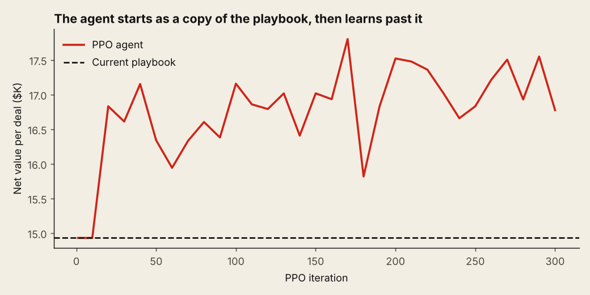
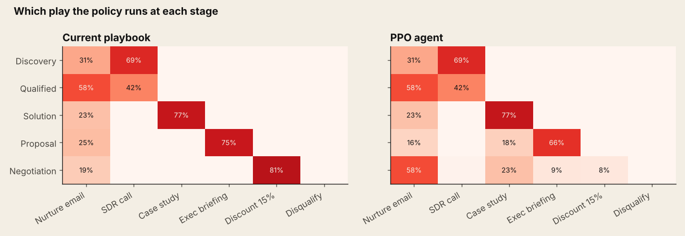
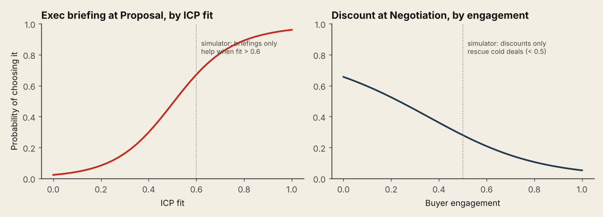
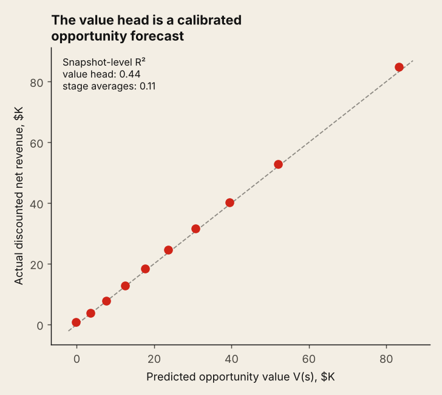
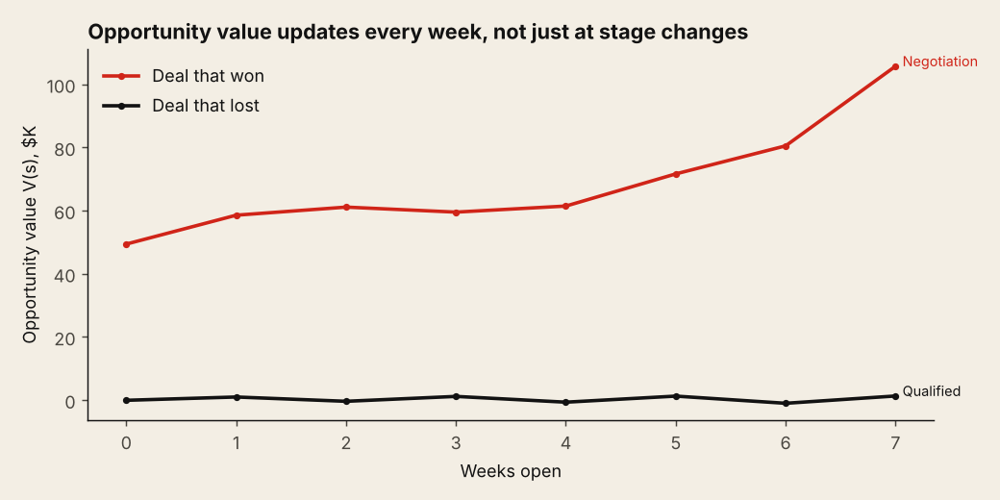
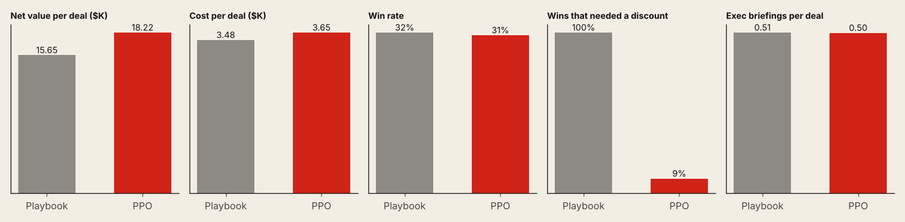

# Pipeline PPO: Teaching a Sales Pipeline to Learn

[](https://colab.research.google.com/github/YOUR-USERNAME/pipeline-ppo/blob/main/notebooks/pipeline_ppo_codealong.ipynb)


A reinforcement learning agent that learns which sales play to run on each open deal, every week, to maximize net revenue. It's built with **PPO, the same algorithm used to train chat models with human feedback (RLHF)**, written from scratch in NumPy so every gradient is visible.

The agent starts as a copy of a sensible human playbook, then learns past it. Along the way its value head becomes something any RevOps team can use: a **dynamic opportunity value** that updates every week.

## 🎓 Code-along

The [Colab code-along](notebooks/pipeline_ppo_codealong.ipynb) builds every piece step by step: the simulator, a neural network with hand-written backprop, behavior cloning, the value loss, GAE, PPO's clipped objective and the KL leash. It includes check-your-understanding questions and experiments, runs free in the browser in 45 to 60 minutes, and needs no GPU.

Study materials in [`docs/`](docs):
* [Reference sheet](docs/reference_sheet.md) ([PDF](docs/reference_sheet.pdf)): every equation, symbol and hyperparameter on two pages
* [Questions](docs/questions.md) for consideration, evaluation (with answer key) and further study
* [Video script](docs/codealong_script.md) for a recorded walkthrough

## How RLHF maps to a sales pipeline

| RLHF for language models | This project |
|---|---|
| Prompt plus tokens so far | A deal: stage, fit, engagement, weeks open, size |
| Next token | Next play: nurture email, SDR call, case study, exec briefing, discount, disqualify |
| Supervised fine-tuned (SFT) model | Policy cloned from the current playbook |
| Reward model score | Closed revenue minus the cost of plays |
| Value head V(s) | Opportunity value: expected net revenue from here |
| KL penalty to the SFT model | KL penalty to the playbook clone |
| PPO clipped update | Same |

## Results

| Metric | Current playbook | PPO agent |
|---|---|---|
| Net value per deal | $15.65K | **$18.22K** |
| Win rate | 31.9% | 31.4% |
| Revenue per deal | $19.14K | $21.87K |
| Wins that needed a discount | 100% | 9% |
| Exec briefings per deal | 0.51 | 0.50 |

**Net value per deal up 16.4%** (90% bootstrap interval: +$1.65K to +$3.46K per deal), measured on the same 8,000 fresh simulated deals. Win rate barely moved. The gain came from *where* the agent spent effort, not from winning more.

### It learns past the playbook



### It changed the late-stage motion and left the rest alone



Early stages barely changed: the playbook was already right there, and the KL penalty charges for every departure. At Proposal and Negotiation, the agent diversified.

### It discovered the market's hidden rules



The simulator hides two rules the playbook ignores: exec briefings only pay off on strong-fit deals (fit above 0.6), and discounts only rescue cold negotiations (engagement below 0.5). The agent was never told either. It found both from outcomes alone.

### The value head is a calibrated opportunity forecast



Trained only with the value loss, the critic predicts discounted net revenue from any deal state. At the snapshot level it explains **R² 0.44** of the variation, versus **0.11** for the classic stage-weighted forecast. That part works on historical CRM data today, without ever letting an agent act.





## How it works

| Piece | What it does | File |
|---|---|---|
| Simulator | 256 deals in parallel; weekly stage, loss and engagement dynamics with hidden rules | `pipeline_ppo/env.py` |
| Network | Two-layer MLP, hand-written backprop, Adam, gradient clipping | `pipeline_ppo/nets.py` |
| Behavior cloning | Cross-entropy imitation of the playbook, frozen as the reference policy | `pipeline_ppo/ppo.py` |
| Advantages | Generalized advantage estimation (γ = 0.99 weekly, λ = 0.95) | `pipeline_ppo/ppo.py` |
| PPO update | Clipped ratio objective, entropy bonus, KL to reference, value loss ½(V − R)² | `pipeline_ppo/ppo.py` |
| Evaluation | Head-to-head on identical fresh deals, bootstrap interval | `run_demo.py` |

## Run it

```bash
pip install -r requirements.txt
python run_demo.py     # about 2 minutes on a laptop CPU; writes charts, CSVs, weights and results.md to ./outputs
pytest -q              # 6 tests: backprop, GAE, value loss, cloning, environment, PPO beats the playbook
```

## Repository structure

```
pipeline_ppo/     simulator, NumPy neural network and PPO
notebooks/        Colab code-along that builds every piece step by step
docs/             reference sheet, question set and video script
run_demo.py       trains the agent and regenerates outputs/
tests/            6 tests
outputs/          charts, CSVs, trained weights and results.md
```

## Limitations and what transfers to real pipelines

* **It's a simulator.** The rules were chosen to be learnable and checkable. Real buyers are messier, and the hidden rules have to be estimated, not written down.
* **PPO learns by trying.** You can't run millions of experiments on live enterprise deals. In practice: train the value head on historical snapshots, use contextual bandits with randomized holdouts for next-best-action, and reserve PPO for a simulator calibrated to your data.
* **Logged CRM data is biased.** Reps already send exec briefings to the deals they expect to win, so naive analysis overstates the play. That's the same causal problem incrementality testing solves.
* **The KL leash is a governance feature.** It lets an AI improve a sales motion without rewriting it overnight.

Companion projects: [geo incrementality testing](https://github.com/YOUR-USERNAME/geo-incrementality), [marketing mix modeling](https://github.com/YOUR-USERNAME/mmm-from-first-principles) and the [self-auditing ad budget agent](https://github.com/YOUR-USERNAME/self-auditing-ad-agent).

## About

Built by **Na'im McKee**, a marketing executive who has run attribution, forecasting and demand generation in-house, while studying RLHF in DeepLearning.AI's *Generative AI with Large Language Models*. [LinkedIn](https://linkedin.com/in/naimmckee)
